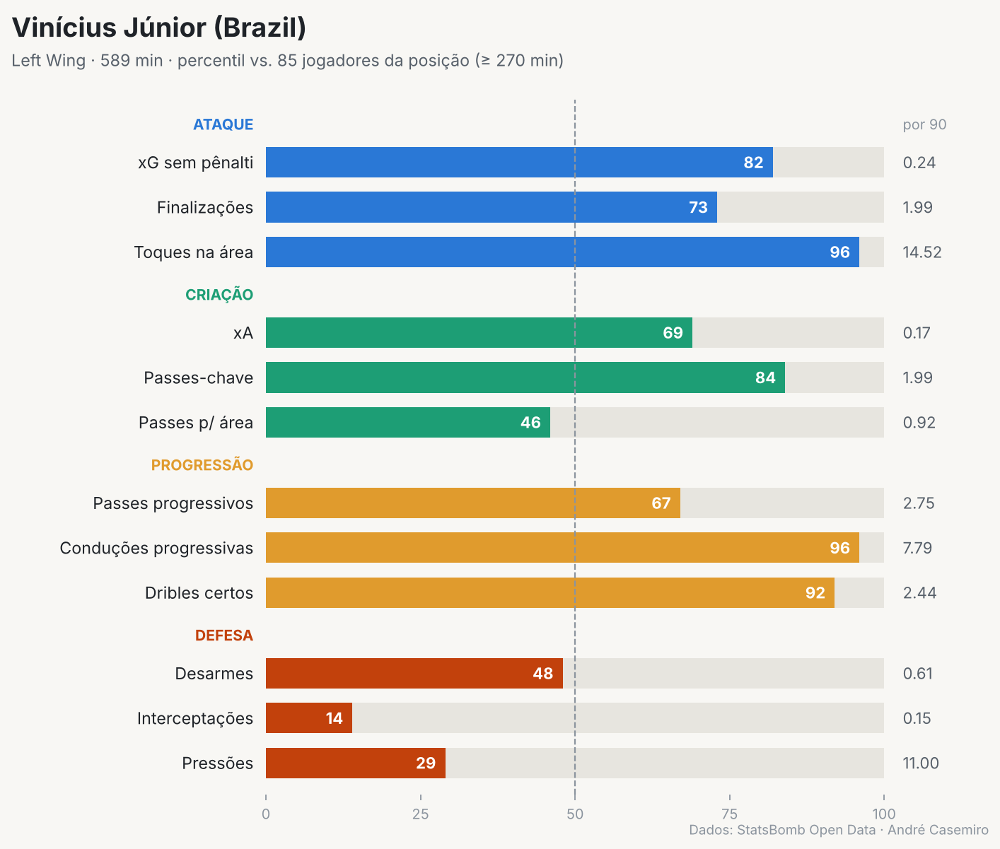
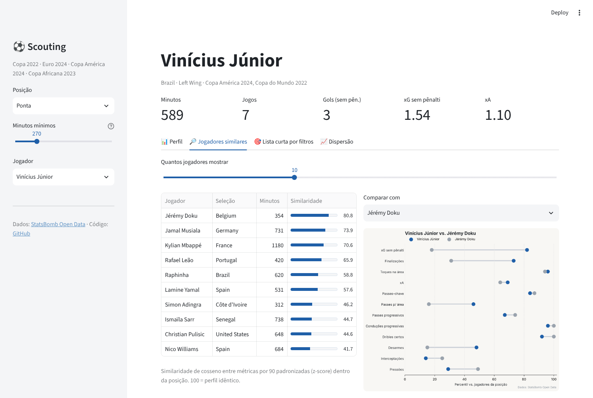
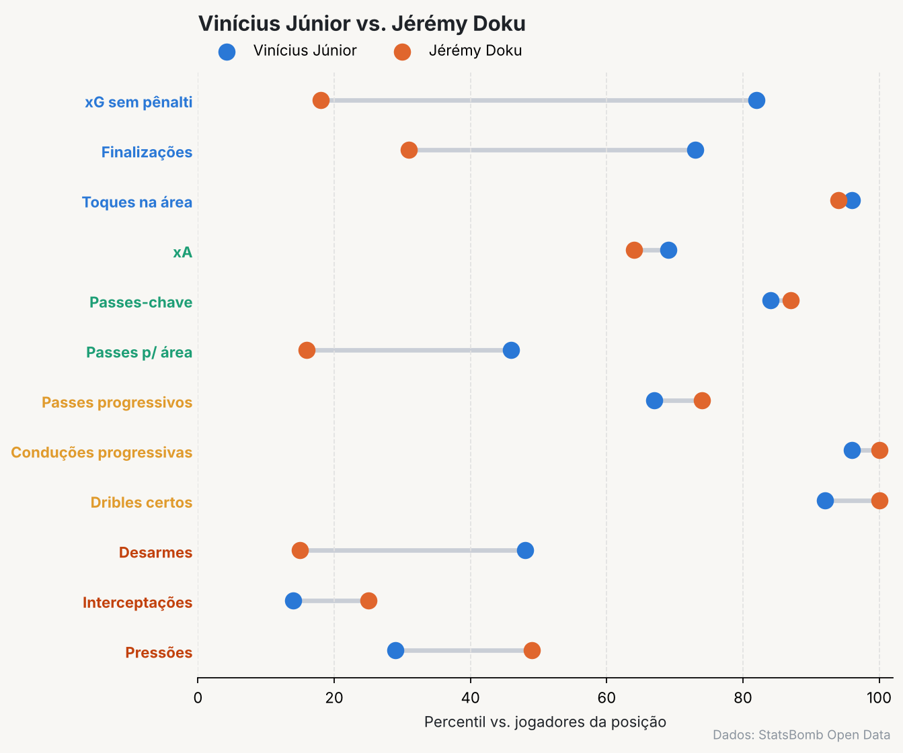
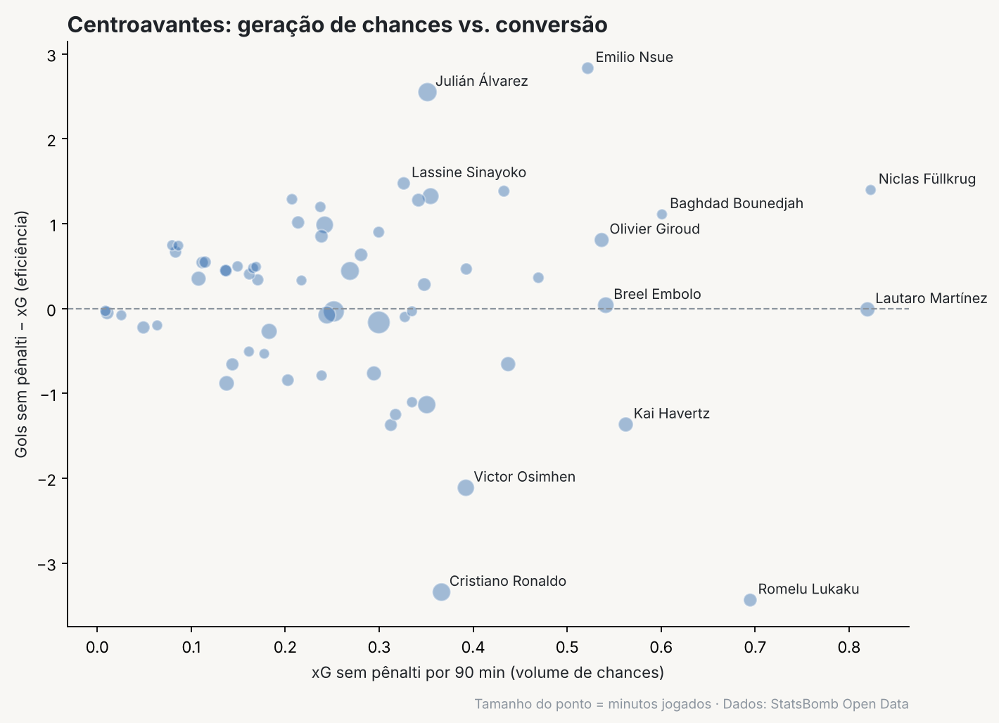

# ⚽ Scouting com dados: busca de jogadores por similaridade

> Quem tem o perfil mais parecido com um jogador-alvo? Um sistema de scouting em Python que transforma **eventos de partida** em **perfis estatísticos** e encontra substitutos por **similaridade de cosseno**.



## 🖥️ App interativo (Streamlit)

Além do notebook, o projeto tem um **app em Streamlit** para explorar qualquer jogador: perfil de percentis, busca de similares com comparação, lista curta por filtros e dispersão interativa.



```bash
streamlit run app.py
```

## Pergunta de negócio

Um clube perdeu um titular (ou não pode pagar por ele). O departamento de scouting precisa de uma **lista curta** de atletas com estilo parecido para assistir em vídeo. Este projeto automatiza esse primeiro filtro.

## Dados

- **Fonte:** [StatsBomb Open Data](https://github.com/statsbomb/open-data), com dados de evento (cada passe, chute, drible, pressão etc., com coordenadas).
- **Recorte:** Copa do Mundo 2022, Euro 2024, Copa América 2024 e Copa Africana 2023.
- **Volume:** 199 partidas e cerca de 1.700 jogadores. A análise usa os 683 jogadores com 270 minutos ou mais.

## Metodologia

1. **Minutos jogados** reconstruídos a partir dos eventos (titulares, substituições e expulsões, sem contar a disputa de pênaltis).
2. **~20 métricas por 90 minutos**, divididas em finalização (npxG, chutes, toques na área), criação (xA, passes-chave, passes para a área), progressão (passes e conduções progressivas, dribles), retenção (volume e precisão de passe, perdas) e defesa (desarmes, interceptações, recuperações, pressões).
   - *Ação progressiva:* aproxima a bola pelo menos 25% do gol adversário, começando fora do terço defensivo.
3. **Padronização (z-score) dentro da posição**: pontas são comparados com pontas, volantes com volantes.
4. **Similaridade de cosseno** entre os vetores de métricas, para comparar o *estilo* e não só o volume.
5. **Visualização** com barras de percentil por fase do jogo e gráficos de comparação (matplotlib).

## Resultados

### 1. Substitutos para Vinícius Júnior

| # | Jogador | Seleção | Minutos | Similaridade |
|---|---------|---------|--------:|-------------:|
| 1 | Jérémy Doku | Bélgica | 354 | 80.8 |
| 2 | Jamal Musiala | Alemanha | 731 | 73.9 |
| 3 | Kylian Mbappé | França | 1180 | 70.6 |
| 4 | Rafael Leão | Portugal | 420 | 65.9 |
| 5 | Raphinha | Brasil | 620 | 58.8 |

O modelo agrupa pontas de **condução e 1x1** e deixa de fora os pontas cruzadores, o que bate com a leitura do jogo.



### 2. Centroavantes: volume de chances vs. conversão



### 3. Lista curta por filtros: volante construtor

Filtro de percentil ≥ 60 em volume de passe, precisão e passes progressivos, ordenado por ações defensivas. Os primeiros nomes são **Vitinha, Bruno Guimarães e Pierre-Emile Højbjerg**.

## Como rodar

```bash
git clone https://github.com/andrecasemiro28/scouting-futebol.git
cd scouting-futebol
pip install -r requirements.txt

streamlit run app.py            # app interativo (usa a tabela já processada)

# opcional: refazer a tabela do zero e abrir o notebook
python -m src.features          # baixa os dados (~550 MB, 1x) e gera data/processed/player_stats.csv
pip install jupyter && jupyter notebook notebooks/01_scouting_similaridade.ipynb
```

Uso direto em Python:

```python
import pandas as pd
from src.similarity import find_similar

df = pd.read_csv("data/processed/player_stats.csv")
find_similar(df, "Lamine Yamal", n=5)
```

## Estrutura

```
├── app.py                          # app Streamlit
├── data/processed/player_stats.csv   # tabela final: 1 linha por jogador
├── notebooks/01_scouting_similaridade.ipynb
├── reports/figures/                  # gráficos gerados
└── src/
    ├── download.py     # download com cache da StatsBomb Open Data
    ├── features.py     # minutos jogados + métricas por 90
    ├── similarity.py   # percentis e busca por similaridade
    └── viz.py          # perfil de percentis, comparação e dispersão
```

## Limitações e próximos passos

- Torneios de seleções são **amostras pequenas** (3 a 7 jogos por atleta). O próximo passo é aplicar o modelo a uma temporada completa de liga.
- **Ajuste por posse de bola** nas métricas defensivas.
- **Clusterização de estilos** (K-Means + UMAP) para descobrir os "arquétipos" de cada posição.

---

**Autor:** André Casemiro, estudante de Ciência de Dados e IA (IBMEC RJ)
Dados: StatsBomb Open Data, de uso não comercial e com atribuição.
